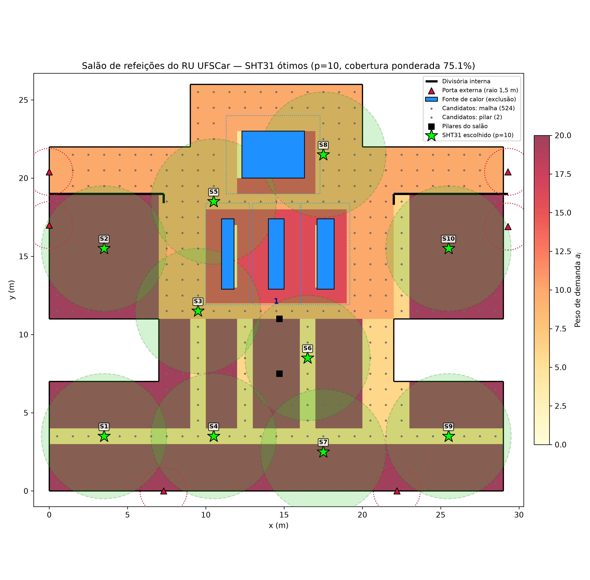
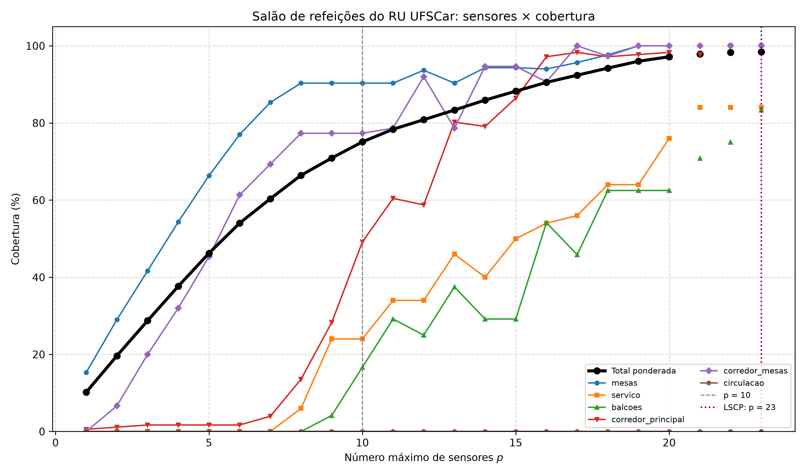
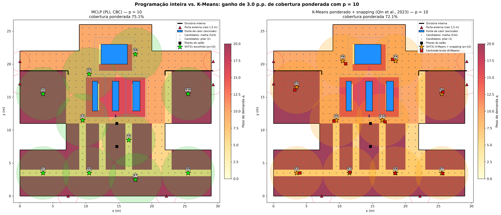

# Posicionamento ótimo de sensores de temperatura no Restaurante Universitário da UFSCar

**Um modelo de cobertura máxima em programação inteira**

Projeto final da disciplina **SME0510 – Pesquisa Operacional** (ICMC/USP São Carlos), 2026.
Autores: [Nome 1], [Nome 2], [Nome 3].

O projeto decide quantos sensores de temperatura instalar, e onde, para monitorar da melhor forma possível o **salão de refeições do Restaurante Universitário (RU) da UFSCar, em São Carlos**. O problema é modelado como um **Problema de Localização de Cobertura Máxima** (*Maximal Covering Location Problem*, MCLP; Church e ReVelle, 1974) em programação linear inteira binária e resolvido em Python com PuLP e o solver CBC.

| Documento | Conteúdo |
|---|---|
| [docs/relatorio_sme0510_sensores_ru.docx](docs/relatorio_sme0510_sensores_ru.docx) | relatório final (resumo, introdução, revisão, modelagem, experimentos, conclusões) |
| [docs/regras_modelagem_salao.md](docs/regras_modelagem_salao.md) | todas as regras do modelo, com conjuntos, parâmetros e restrições numeradas (R1 a R32) |

## O problema

Com no máximo `p` sensores, onde instalá-los para cobrir a maior "exposição térmica" possível dos alunos?

- **Domínio:** o salão de refeições, com cerca de 29 × 26 m, descontados os dois pátios laterais. A geometria foi digitalizada da planta baixa ([img/2_planta14.webp](img/2_planta14.webp)) e está em [data/salao_geometria.json](data/salao_geometria.json).
- **Malha:** pontos a cada 1 m, num total de 626 pontos de demanda.
- **Pesos:** representam a exposição dos ocupantes, isto é, a densidade de pessoas multiplicada pelo tempo de permanência.

  | Zona | Peso |
  |---|---|
  | mesas | 20 |
  | fila diante dos balcões | 16 |
  | corredor principal (entradas, eixo central e hall) | 10 |
  | corredores entre mesas | 6 |
  | balcões térmicos | 4 |

- **Sensor:** SHT31 (±0,2 °C). O raio de cobertura vem de `S = (ΔT_max − e)/g`: 4,0 m nas mesas e corredores e 2,29 m perto dos balcões, onde o gradiente é maior.
- **Candidatos:** qualquer ponto da malha, com o sensor suspenso do teto (526 locais). Ficam excluídos os pontos a menos de 1,5 m das portas externas e a menos de 1,0 m dos balcões térmicos.
- **Linha de visada:** um sensor não cobre pontos atrás de paredes ou das divisórias que separam as alas de mesas do corredor de entrada.

## Modelo

```
max  Σ_{i∈I'} a_i · y_i

s.a. (1)  Σ_{j∈N_i} x_j ≥ y_i     ∀ i ∈ I'     i só é coberto se houver sensor em N_i
     (2)  Σ_{j∈J}  x_j ≤ p                     limite de sensores
     (3)  x_j ∈ {0,1}             ∀ j ∈ J
     (4)  y_i ∈ {0,1}             ∀ i ∈ I'
```

- `N_i` é o conjunto de candidatos a até `S_i` metros do ponto `i`, com linha de visada livre.
- `I'` são os pontos com pelo menos um candidato ao alcance.
- O LSCP (mínimo de sensores para cobrir tudo o que é alcançável) define até onde vai a varredura de `p`.

## Resultados principais

| p | Cobertura total | Mesas | Corredor principal | Fila/serviço |
|---|---|---|---|---|
| 5 | 46,2% | 66,3% | 1,7% | 0% |
| 8 | 66,4% | 90,3% | 13,6% | 6,0% |
| **10** | **75,1%** | **90,3%** | **49,2%** | **24,0%** |
| 16 | 90,5% | 94,0% | 97,2% | 54,0% |
| 23 (LSCP) | 98,4% | 100% | 100% | 84,0% |

- **Prioridade das mesas:** os primeiros 8 sensores vão quase todos para as mesas, que já ficam 90% cobertas com p = 8.
- **Cobertura máxima:** 23 sensores cobrem tudo o que é alcançável, o que dá 98,4% do peso total. Os 12 pontos restantes ficam perto dos balcões e não têm nenhum candidato ao alcance.
- **Tempo:** os 23 modelos foram resolvidos com ótimo provado, em cerca de 41 s no total (de 0,2 a 7,6 s cada).

| Solução para p = 10 | Curva de trade-off |
|---|---|
|  |  |

## Experimentos de comparação

### Ótimo contra K-Means (Qin et al., 2023)

O MCLP exato é comparado com o método geométrico de Qin et al. (2023), para `p = 1..15`:

1. **K-Means ponderado:** agrupa os pontos de demanda ponderados por `a_i`, com inicialização K-Means++ ponderada e iteração de Lloyd.
2. **Snapping:** cada centroide vai para o candidato válido mais próximo ainda não escolhido.
3. **Avaliação:** usa a mesma matriz de cobertura `N_i` e os mesmos pesos do MCLP, com a melhor de 5 sementes.

| p | MCLP | K-Means | Ganho |
|---|---|---|---|
| 3 | 28,7% | 19,2% | 9,6 p.p. |
| 5 | 46,2% | 38,5% | 7,8 p.p. |
| 10 | 75,1% | 72,1% | 3,0 p.p. |
| 15 | 88,2% | 84,7% | 3,5 p.p. |

O ganho médio é de **5,3 p.p.**, e o K-Means não empata com o ótimo em nenhum valor de `p`.



### Ótimo contra uma escolha manual

O grupo marcou 12 posições "no olho" ([img/estimativa_sensores.png](img/estimativa_sensores.png), coordenadas em [data/salao_sensores_manuais.json](data/salao_sensores_manuais.json)). Elas foram avaliadas exatamente onde estão, com as mesmas regras.

| Método (p = 12) | Cobertura | Mesas | Fila/serviço |
|---|---|---|---|
| Escolha do grupo | 73,6% | 86,3% | 6,0% |
| K-Means | 77,6% | 92,0% | 16,0% |
| MCLP (ótimo) | **80,8%** | **93,7%** | **34,0%** |

Com os mesmos 12 sensores, o ótimo cobre 7,3 p.p. a mais, com a maior diferença na fila diante dos balcões.

### Sensor barato (DHT22) contra sensor melhor (SHT31)

Trocar o SHT31 (±0,2 °C) pelo DHT22 (±0,5 °C) multiplica todos os raios por (1,0 − 0,5)/(1,0 − 0,2) = 0,625. O raio cai para 2,5 m nas mesas e 1,43 m perto dos balcões.

| | SHT31 | DHT22 |
|---|---|---|
| Cobertura com 10 sensores | 75,1% | 39,8% |
| Sensores para chegar a 75% | 10 | 23 (75,5%) |
| Sensores para cobrir tudo o que é alcançável (LSCP) | 23 (98,4%) | 42 (96,1%) |

O SHT31 compensa se cada ponto de medição com ele custar menos de 2,3 vezes o ponto com DHT22.

### Malha 1,0 m contra 0,5 m e raio pela metade

Toda solução é avaliada também na malha de 0,5 m, com as mesmas regras.

| p = 10 | MCLP 1,0 m | MCLP 0,5 m | K-Means 1,0 m | K-Means 0,5 m |
|---|---|---|---|---|
| Raio de 4 m | 77,9% | 77,1% | 75,8% | 74,4% |
| Raio de 2 m (metade) | 26,3% | 26,6% | 21,5% | 20,7% |

- **Malha:** refinar para 0,5 m muda a cobertura em menos de 2 p.p. Em troca, o MCLP fica 13 vezes mais lento: 208 s contra 16 s somando p = 1 a 15, com no máximo 63 s num único modelo.
- **Raio:** com raio menor, a vantagem relativa do ótimo sobre o K-Means sobe de 20% para cerca de 40%.

## Como executar

Requer Python 3.12 ou superior (testado com 3.14) e PuLP **3.x**. A versão 4.x do PuLP não traz mais o CBC embutido.

```bash
python -m venv .venv
.venv/bin/python -m pip install -r requirements.txt

.venv/bin/python main.py --cenario salao                    # varredura p = 1..23, LSCP e K-Means (~1 min)
.venv/bin/python main.py --cenario salao --p 10 --apenas-p  # só p = 10 (~5 s)
.venv/bin/python main.py --cenario salao --manual           # escolha manual x K-Means x MCLP (~15 s)
.venv/bin/python main.py --cenario salao --comparar-malhas --tempo-limite 600  # malhas 1,0 x 0,5 m (~4 min)
.venv/bin/python main.py --cenario salao --comparar-malhas --tempo-limite 600 --fator-raio 0.5  # raio pela metade
.venv/bin/python main.py --cenario salao --fator-raio 0.625  # sensor DHT22 (~1 min)
```

| Pasta | Conteúdo |
|---|---|
| `results/salao/` | cenário principal (SHT31): varredura, comparações com K-Means, escolha manual e malhas |
| `results/salao_raio050/` | comparação de malhas com o raio pela metade (`--fator-raio 0.5`) |
| `results/salao_raio062/` | sensor DHT22 (`--fator-raio 0.625`): varredura, comparação com K-Means e p = 23 |

Cada pasta traz CSVs com cobertura total e por zona, tempos, status do solver e posições dos sensores, além das figuras (300 dpi). Para o código, outra opção de `--fator-raio` grava em `results/salao_raio<fator × 100>/`.

## Cenários anteriores

O código mantém dois cenários desenvolvidos antes do salão. Os resultados deles não estão no repositório, mas podem ser gerados de novo.

- **Laboratório de computadores (USP), `--cenario lab`:** planta de 10 × 7 m ([img/plantaLaboratorio.jpeg](img/plantaLaboratorio.jpeg)) com sala de racks separada por divisória de vidro e sensores DHT22 nas paredes. Com p = 6, cobre 96,85%.
- **RU completo, `--cenario ru`:** 20 cômodos (salão, cozinha, câmaras, despensa e apoio) com DHT22 nas paredes e ao menos 1 sensor obrigatório na câmara frigorífica. A geometria está em [data/ru_geometria.json](data/ru_geometria.json).

## Estrutura

```
main.py                         linha de comando: otimiza, salva os CSVs e gera os gráficos
requirements.txt                dependências (PuLP 3.x)
src/ru_environment.py           constrói I, J e N_i a partir de um JSON de geometria
src/cenarios.py                 carrega os cenários (salao, ru, lab) com a mesma interface
src/mclp_solver.py              MCLP, LSCP e K-Means + snapping, varreduras de p
src/experimentos.py             comparações entre malhas e com a escolha manual
src/visualizer.py               figuras em matplotlib (300 dpi)
src/lab_environment.py          cenário do laboratório (geometria no código)
data/salao_geometria.json       geometria, pesos, sensor e raios do salão
data/salao_sensores_manuais.json  posições escolhidas à mão pelo grupo
data/ru_geometria.json          geometria do RU completo
docs/                           relatório final (.docx) e regras de modelagem
articles/                       artigos de referência
img/                            planta, cortes e elevações do RU (Graco Projetos) e marcações do grupo
results/                        saídas dos experimentos
```

## Limitações

- **2D e estático:** o modelo considera um plano a 1,1 m (ISO 7726). Não representa a variação vertical de temperatura nem a variação ao longo do dia, e um sensor suspenso do teto fica, na prática, a 2–2,5 m de altura.
- **Cobertura simplificada:** a cobertura é binária (coberto ou não) e igual em todas as direções.
- **Premissas não medidas:** os gradientes, a tolerância e os pesos são premissas do grupo.
- **Geometria a confirmar:** portas, divisórias, mesas e balcões estão marcados `confirmar` no JSON e precisam ser conferidos numa visita ao RU.

## Referências

- BAHRIN, S. Z.; MUHAMAD, N. A.; LAW, K. H. et al. Study on Classroom Temperature Distribution in Hybrid Cooling System at Different Air Conditioner Setpoints. *2026 IEEE 6th International Conference in Power Engineering Applications (ICPEA)*, 2026. DOI 10.1109/ICPEA69349.2026.11533711.
- CHURCH, R.; REVELLE, C. The maximal covering location problem. *Papers of the Regional Science Association*, v. 32, p. 101–118, 1974.
- ERICKSON, P.; CLINE, M.; TIRPANKAR, N.; HENDERSON, T. Gaussian processes for multi-sensor environmental monitoring. *2015 IEEE International Conference on Multisensor Fusion and Integration for Intelligent Systems (MFI)*, San Diego, 2015.
- QIN, Z.; GUO, J.; LI, Y.; ZHANG, L. Sensor Optimization in Large Spaces Based on RBF Neural Networks and K-means Cluster Analysis. *2023 9th International Conference on Network and Information Systems for Computers (ICNISC)*, 2023. DOI 10.1109/ICNISC60562.2023.00085.
- ISO 7726:1998. *Ergonomics of the thermal environment — Instruments for measuring physical quantities*.
- ANSI/ASHRAE Standard 55. *Thermal Environmental Conditions for Human Occupancy*.
